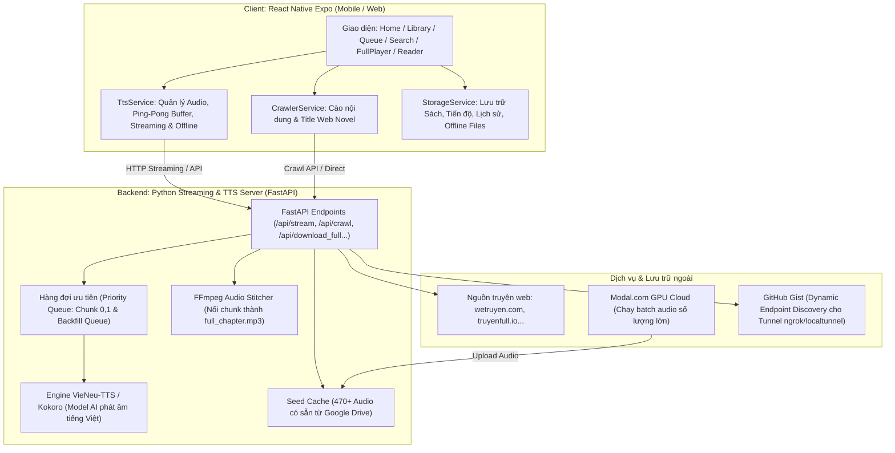

# TỔNG QUAN TOÀN BỘ HỆ THỐNG APPSACHNOI (AUDIOVERSE)

> **Tài liệu tổng hợp kiến trúc, tính năng, công nghệ & luồng dữ liệu**  
> **Dành cho:** Review toàn diện hệ thống Client (React Native Expo) & Backend Engine (Python Streaming TTS).  
> **Cập nhật:** Tháng 10/2026.

---

## 1. TỔNG QUAN DỰ ÁN

**AppSachNoi (AudioVerse)** là ứng dụng sách nói và truyện chữ đa nền tảng (iOS, Android, Web), tích hợp công nghệ **AI Text-to-Speech (TTS) thế hệ mới (VieNeu-TTS / Kokoro)** với khả năng:
- **Nghe trực tuyến siêu tốc (Zero-Latency Streaming):** Bắt đầu phát âm thanh chỉ sau 1–2 giây thông qua kỹ thuật Ping-Pong Chunk Streaming.
- **Đồng bộ chữ - âm thanh thời gian thực (Karaoke / Sentence Sync):** Chữ đổi màu và tự động cuộn theo giọng đọc audio; bấm vào câu văn bất kỳ để tua audio đến đúng đoạn đó.
- **Tải và nghe ngoại tuyến (Offline Playback):** Tải nguyên chương dạng MP3 chất lượng cao kèm toàn bộ văn bản để nghe khi không có kết nối Internet.
- **Cào truyện Web tự động (Dynamic Web Novel Crawler):** Tự động bóc tách nội dung, tiêu đề và phân chương từ các trang truyện web lớn (WeTruyen, TruyenFull, v.v.).
- **Tối ưu chi phí & tài nguyên bằng Seed Cache & Cloud Batch:** Tận dụng 470+ file audio có sẵn từ Google Drive và hệ thống sinh audio hàng loạt trên Modal GPU Cloud.

---

## 2. KIẾN TRÚC TỔNG THỂ (SYSTEM ARCHITECTURE)

Hệ thống được thiết kế theo mô hình lai (Hybrid Client-Server):



---

## 3. CÁC TÍNH NĂNG ĐÃ HOÀN THÀNH & ĐANG HOẠT ĐỘNG

### 3.1. Trình phát âm thanh (Audio Player Engine)
- **Kỹ thuật Ping-Pong Buffer:** Dùng 2 đối tượng player song song (`expo-audio`). Khi Chunk A sắp kết thúc, Chunk B đã được tải trước và bắt đầu phát với độ trễ 0ms (liền mạch, không ngắt quãng giữa các câu).
- **Phát Seed Cache thông minh:** Nếu chương đã có sẵn trên Google Drive, phát ngay lập tức từ Drive mà không tiêu tốn GPU/CPU của máy chủ.
- **Tải Offline hoàn chỉnh:**
  - Tải file gộp toàn bộ chương `full_chapter.mp3`.
  - Tự động kiểm tra và sinh bù các chunk còn thiếu nếu người dùng yêu cầu tải một chương chưa từng nghe hết.
  - Tự động xóa file rác, file lỗi hoặc file hỏng do đứt mạng.
- **Hẹn giờ tắt (Sleep Timer):** Đặt thời gian tự tắt sau 15, 30, 45, 60 phút hoặc khi đọc hết chương hiện tại.
- **Tùy chỉnh tốc độ đọc:** Từ 0.5x, 0.75x, 1.0x, 1.25x, 1.5x đến 2.0x.

### 3.2. Trình đọc sách & Đồng bộ Karaoke (Reader & Sentence Sync)
- **Tự động cuộn theo giọng đọc:** Mỗi câu đang được AI phát âm sẽ được làm nổi bật (highlight màu riêng).
- **Interactive Sentence Seek:** Người dùng chạm vào bất kỳ câu nào trong văn bản, app sẽ tự động tua âm thanh đến chính xác câu đó.
- **Chế độ đọc ngoại tuyến:** Toàn văn của chương được lưu cùng lúc với file audio, ngắt kết nối mạng vẫn đọc và nghe đồng bộ bình thường.
- **Tùy chỉnh giao diện đọc:** Đổi cỡ chữ, phông chữ, chế độ sáng/tối (Dark Mode).

### 3.3. Quản lý sách & Cào truyện Web (Web Novel & Library)
- **Cào tự động (Web Crawler):** Nhập link truyện từ WeTruyen, TruyenFull hoặc các trang web truyện chữ, hệ thống tự động:
  - Bóc tách tiêu đề chương thông minh (lọc bỏ các dấu hai chấm thừa, ưu tiên thẻ `<title>` chi tiết).
  - Tự động lấy danh sách chương theo dải (Batch Range 1–40 chương) song song với tốc độ cao.
  - Làm sạch văn bản, loại bỏ quảng cáo, rác HTML, định dạng lại thành các đoạn văn chuẩn cho TTS.
- **Quản lý thư viện:**
  - Lưu tiến độ đọc gần nhất (chương đang đọc, vị trí giây đang nghe).
  - Danh sách yêu thích, lịch sử nghe.
  - Phân loại sách: Sách nói, Truyện web, Sách tải về, File cục bộ.
- **Thêm file thủ công:** Hỗ trợ nhập file EPUB, PDF, TXT hoặc URL tùy chỉnh.

### 3.4. Hệ thống Giọng đọc AI (AI Voice Selector)
- Tích hợp các giọng đọc AI VieNeu & Kokoro chất lượng cao:
  - Giọng Bắc / Nam chuẩn.
  - Giọng Nam trầm ấm, Giọng Nữ nhẹ nhàng truyền cảm.
  - Thử giọng mẫu (Audio Audition) trước khi áp dụng.

### 3.5. Hệ thống Server & Batch Streaming (`audioverse_batch`)
- **FastAPI Server (`server_streaming.py`):**
  - Chạy uvicorn đa luồng, hỗ trợ CORS, tích hợp bộ nhớ đệm cache thư mục.
  - Cung cấp các API: `/api/stream`, `/api/stream/chunk`, `/api/stream/status`, `/api/stream/download_full`, `/api/crawl`, `/api/crawl_chapter_titles`, `/api/index`.
  - Cơ chế **Preemption (Ưu tiên ngắt)**: Khi người dùng chuyển sang nghe chương mới, server tự động hủy các tiến trình sinh audio cũ để dồn 100% tài nguyên cho chương mới.
- **Quản lý máy chủ (`control.sh`):**
  - Khởi động, dừng, kiểm tra trạng thái tiến trình (PID & Port check).
  - Tự động thiết lập đường hầm Tunnel (Localtunnel / Ngrok) và cập nhật URL trực tiếp lên GitHub Gist bí mật để App Client tự động tìm thấy mà không cần sửa cứng IP.

---

## 4. CẤU TRÚC THƯ MỤC DỰ ÁN

```
AppSachNoi/
├── App.tsx                      # Component trung tâm: Điều phối State, Routing, Navigation, Player Engine
├── app.json                     # Cấu hình Expo SDK 57 (Plugins, Orientation, Scheme, Permissions)
├── package.json                 # Dependencies: Expo 57, React 19, React Native 0.86, expo-audio
├── tsconfig.json                # Cấu hình TypeScript
│
├── src/
│   ├── components/              # Các thành phần giao diện (UI Components)
│   │   ├── FullPlayerModal.tsx      # Giao diện Trình phát Full: bìa sách, tua audio, karaoke text, speed
│   │   ├── MiniPlayer.tsx           # Thanh phát thu nhỏ ở đáy màn hình
│   │   ├── ChapterListModal.tsx     # Danh sách chương, nạp tiêu đề động, trạng thái tải offline
│   │   ├── VoiceSelectorModal.tsx   # Hộp thoại chọn và nghe thử giọng AI
│   │   ├── SleepTimerModal.tsx      # Hẹn giờ tắt ứng dụng
│   │   ├── UrlImportModal.tsx       # Modal nhập link truyện web hoặc custom URL
│   │   ├── BookCard.tsx / NovelCard.tsx # Thẻ hiển thị sách/truyện ở trang chủ
│   │   ├── Header.tsx / SearchBar.tsx
│   │   └── BatchQueueModal.tsx      # Quản lý hàng đợi sinh batch
│   │
│   ├── screens/                 # Các màn hình chính
│   │   ├── HomeScreen.tsx           # Trang chủ: Đang đọc dở, gợi ý, danh mục
│   │   ├── LibraryScreen.tsx        # Thư viện cá nhân: Đã tải, yêu thích, lịch sử
│   │   ├── QueueScreen.tsx          # Hàng đợi phát và tải offline
│   │   └── SearchScreen.tsx         # Tìm kiếm sách theo tên, tác giả, thể loại
│   │
│   ├── services/                # Tầng dịch vụ & Xử lý nghiệp vụ
│   │   ├── ttsService.ts            # Quản lý toàn bộ vòng đời Audio, Ping-Pong, Streaming & Cache
│   │   ├── crawlerService.ts        # Thu thập nội dung web novel, parse HTML, trích xuất title
│   │   ├── storageService.ts        # Lưu trữ AsyncStorage: Thư viện, tiến độ, offline metadata
│   │   ├── batchService.ts          # Quản lý tác vụ tạo audio hàng loạt
│   │   └── edgeTtsClient.ts         # Fallback client khi dùng Edge-TTS
│   │
│   ├── types/                   # Định nghĩa TypeScript interface (Book, Chapter, PlaybackState...)
│   ├── theme/                   # Bảng màu, typography, khoảng cách
│   └── data/                    # Dữ liệu tĩnh mẫu (books.ts, novels.ts)
│
└── audioverse_batch/            # Module Backend Engine (Python TTS Server)
    ├── server_streaming.py      # FastAPI Server: Streaming, Queue, Auto-stitch MP3, Crawler
    ├── control.sh               # Shell script điều khiển server, port check & tunnel
    ├── requirements_streaming.txt # Thư viện Python: fastapi, uvicorn, torch, beautifulsoup4...
    ├── modal_batch_vieneu.py    # Kịch bản sinh âm thanh quy mô lớn trên Modal GPU Cloud
    ├── batch_upload_drive.py    # Tự động đẩy file audio lên Google Drive tạo Seed Cache
    └── .gist.env                # Cấu hình Token & ID để tự động cập nhật Public Server URL
```

---

## 5. THÔNG SỐ CÔNG NGHỆ CHÍNH (TECH STACK)

| Thành phần | Công nghệ / Thư viện | Ghi chú |
| :--- | :--- | :--- |
| **Mobile Framework** | React Native 0.86, Expo SDK 57 | Cross-platform (Android, iOS, Web) |
| **Ngôn ngữ** | TypeScript 6, Python 3.11 | Type-safe 100% (tsc 0 errors) |
| **Trình phát âm thanh** | `expo-audio` | SDK 57 module mới nhất, hỗ trợ dual-player ping-pong |
| **Lưu trữ cục bộ** | `@react-native-async-storage/async-storage` & `expo-file-system` | Lưu cấu hình, cache text & file MP3 offline |
| **Giao diện & Chuyển động** | React Native StyleSheet, LinearGradient, Safe Area Context | Dark Mode hiện đại, tối ưu cho mắt khi đọc đêm |
| **Backend Framework** | FastAPI (Python) | Bất đồng bộ (AsyncIO), hiệu năng cao |
| **Engine TTS AI** | VieNeu-TTS / Kokoro | Model giọng đọc tiếng Việt biểu cảm cao |
| **Xử lý Audio Server** | FFmpeg | Nối chunk, nén định dạng MP3 64k tối ưu dung lượng |
| **Web Scraping** | BeautifulSoup4, urllib (SSL-bypass & retry) | Thu thập văn bản và tiêu đề từ các web truyện |
| **Đường truyền Dev** | Localtunnel / Ngrok + GitHub Gist | Tự động phát hiện URL máy chủ không cần cấu hình thủ công |

---

## 6. CÁC ĐIỂM MẠNH & ƯU THẾ NỔI BẬT

1. **Trải nghiệm nghe tức thì (Instant Play):** Không phải chờ server chuyển đổi toàn bộ chương (có thể mất 1–2 phút). Người dùng bấm nghe là câu đầu tiên phát ngay trong 1–2 giây, trong khi các câu tiếp theo được âm thầm xử lý ở chế độ nền.
2. **Khả năng Offline hoàn hảo:** Khi tải một chương về máy, toàn bộ âm thanh và chữ đều được tải trọn vẹn, tính năng nhảy câu (Karaoke Seek) hoạt động bình thường ngay cả khi bật chế độ máy bay.
3. **Tiết kiệm tài nguyên thông minh (Hybrid Seed Cache):** Ưu tiên phát Seed Cache từ Google Drive đối với những tác phẩm phổ biến, giúp giảm 90% tải cho GPU/CPU máy chủ.
4. **Không phụ thuộc IP cố định:** Script `control.sh` tự đẩy URL tunnel lên GitHub Gist. Ứng dụng điện thoại tự đọc URL mới nhất từ Gist, đảm bảo luôn kết nối được với server dù server đổi mạng hoặc khởi động lại.

---

## 7. CÁC ĐỀ XUẤT NÂNG CẤP TIẾP THEO (ROADMAP GỢI Ý)

- [ ] **Background Audio Notification:** Bổ sung điều khiển phát/tạm dừng trên màn hình khóa (Lock Screen Notification / Android Media Notification).
- [ ] **Đánh dấu trang (Bookmarks & Notes):** Cho phép người dùng lưu lại những đoạn văn hay và ghi chú cá nhân.
- [ ] **Lựa chọn chất lượng âm thanh:** Cung cấp tùy chọn tải offline ở mức 32kbps (tiết kiệm dung lượng) hoặc 128kbps (chất lượng cao).
- [ ] **Đồng bộ hóa đa thiết bị:** Đưa tiến độ nghe lên cơ sở dữ liệu đám mây (Supabase / Firebase) để chuyển đổi giữa điện thoại và máy tính bảng mượt mà.
